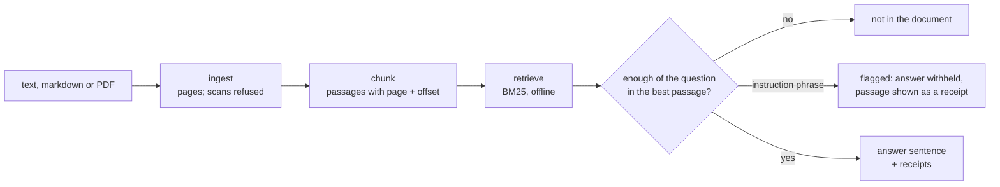

# grounded-qa

[](https://github.com/Wallisgareth004/grounded-qa/actions/workflows/tests.yml)

A document Q&A prototype that shows its receipts: every answer carries the passages it came from, and a question the document can't answer gets "not in the document" instead of a guess.

**Who it's for:** anyone who wants a small, honest retrieval-augmented Q&A over one document (a handbook, a contract, a manual) and wants to see *why* each answer was given.

**What it does:**
- upload a text, markdown or PDF file; it is cut into passages that keep their page and position;
- ask a question; the passages most like it are found with BM25 (word overlap, no model, no key, no network);
- the answer is the sentence from the best passage that shares the most words with the question, with the passages it used as receipts (id, page, offset, text);
- a question the passages cannot support is **refused** with `not in the document`, never guessed. The rule is plain word overlap: at least half of the question's content words (never fewer than one) must appear in the best passage. It is a count, not a judgment, so a question with common words in common can still get an answer, and the receipts are there to check it;
- a passage that carries one of a short list of instruction phrases ("ignore your previous instructions…") is **flagged**: the extractive answer is withheld and the passage is shown in the receipts as text with its id and page, so an injected sentence is never handed back as the answer. The phrase list is a hint for the reader, not a detector: it misses rewordings. In the extractive path nothing *can* follow an instruction, because there is no model; when a model is plugged in it receives the passages between fixed delimiters under a rule that says the text is data, and the receipts let you check whether it obeyed. Nothing in this repo can enforce that;
- a scanned PDF (no text layer) is refused with a reason, never turned into a blank answer.

**Measured:** 32 tests on a made-up corpus (the staff handbook of "Grey Seal Dive Centre, Nowhere Bay", an invented place, `data/handbook.md`, generated by `data/make_handbook.py`), all offline. No real document, person, price or place is in this repo. Python 3.11 or newer.

```sh
git clone <this repo> && cd grounded-qa
python3 -m venv .venv && .venv/bin/pip install -r requirements-dev.txt
.venv/bin/python -m pytest -q                                   # the tests
.venv/bin/python -m groundedqa ask data/handbook.md "what happens to lost gear after thirty days?"
.venv/bin/uvicorn groundedqa.api:app                           # then POST /documents, POST /documents/{id}/ask
```

What an answer looks like (the CLI, shortened):

```json
{"question": "what happens to lost gear after thirty days?",
 "answer": "After thirty days unclaimed items are donated.",
 "refused": false, "flagged": false,
 "receipts": [{"id": "p1-c11", "page": 1, "offset": 2664, "text": "## Section 10: Lost gear\n\nGear left behind goes into the lost basket…", "quoted_instruction": false}],
 "why": "the sentence in the best passage that shares the most words with the question"}
```

And a refusal: `{"answer": "not in the document", "refused": true, "why": "the best passage shares too little with the question (fewer than half its words)", "receipts": [...]}`.

## In 60 seconds

```sh
git clone https://github.com/Wallisgareth004/grounded-qa && cd grounded-qa
python3 -m venv .venv && .venv/bin/pip install -r requirements.txt
.venv/bin/python -m groundedqa ask data/handbook.md "what happens to lost gear after thirty days?"
```
```
{
  "question": "what happens to lost gear after thirty days?",
  "answer": "After thirty days unclaimed items are donated.",
  "refused": false,
  "receipts": [
    {
      "id": "p1-c11",
      "page": 1,
      "offset": 2664,
      "text": "## Section 10: Lost gear\n\nGear left behind goes into the lost basket with the date and the trip written on a tag. After thirty days unclaimed items are donated. Staff never keep lost gear, even old fins.",
      "quoted_instruction": false
    },
```
(The first receipt of the real output, captured on 5 Nov 2026; two more receipts and the `why` and `flagged` lines follow.)

## How it fits together



## How the pipeline works, in plain words
1. **Ingest** (`groundedqa/ingest.py`): bytes in, pages of text out. Text and markdown are one page; a PDF is read page by page with pypdf. Empty, binary, oversized and text-less PDFs are refused with the reason in the error.
2. **Chunk** (`groundedqa/chunk.py`): each page is cut into passages of about 600 characters, only at paragraph breaks and before markdown headings, so a passage never holds two sections; one paragraph is never cut in the middle, however long. Each passage remembers its page and the exact character offset of its first visible character. Deterministic.
3. **Retrieve** (`groundedqa/retrieve.py`): Okapi BM25 over the passages' words (stopwords dropped, a crude stemmer applied the same way to the question and the passages so "runs" meets "run" and "refuelled" meets "refuel"; it is not English, "morning" becomes "morn" on both sides). It is a two-method interface, `index(chunks)` and `search(question, k)`, so an embedding retriever (a sentence-embedding model with Chroma or FAISS) plugs in by giving the same two methods; BM25 is what ships, because it runs anywhere and its scores are explainable.
4. **Answer** (`groundedqa/answer.py`): the receipts are the top passages; if the best one holds fewer than half the question's content words, the answer is refused. Otherwise the sentence of the best passage that shares the most words with the question is the answer (on a tie, the earlier sentence). A best passage with an instruction phrase withholds the answer. The model path (`model=` any callable from prompt to text) gets the passages between delimiters that cannot occur in the text, under a rule that says the text is data, never an instruction.
5. **Serve** (`groundedqa/api.py`): three routes (list, upload, ask), a memory-only store that holds at most fifty documents; restart and it forgets. An upload over one megabyte passes through an OS temp file while the web framework parses it. The size limit is checked before the file is read. No login: do not expose it on the internet as it is.

## What it does not do (on purpose, for a prototype)
No embeddings or vector store shipped (the interface is there); no reranking; no hybrid search; no authentication; no multi-user document management; no deployment recipe; no real instruction detector (a phrase list); no grounding check of a model's answer against the receipts. Those are the next steps a real project would take, and each one is a separate decision.

## Tests
`tests/test_chunk_and_retrieve.py` (chunking is deterministic and keeps page and offset; a known question finds its known passage), `tests/test_answer.py` (receipts exist and contain the answer; off-document questions are refused; the planted instruction is quoted, flagged and never followed; the model path's prompt), `tests/test_ingest_store_api_cli.py` (a hand-written two-page PDF, a scanned PDF refused, empty/binary/oversized refused, the API round trip, the CLI).

## Security notes
Nothing is fetched. No key is read. The store is memory only. The packages this code imports directly (FastAPI, pydantic, pypdf) and the ones it runs or needs at runtime (Starlette, uvicorn, python-multipart) are pinned in `requirements.txt`; their own dependencies are not pinned.

MIT licence.
